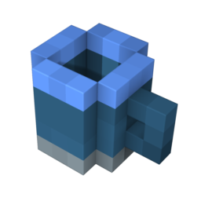
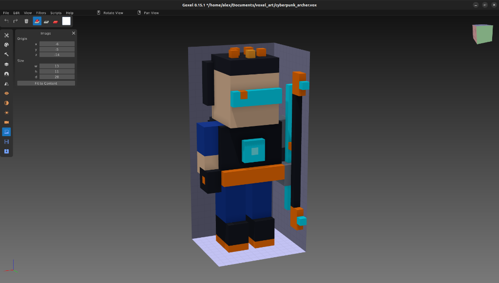

# Goxel MCP Server 🧊🤖

<p align="center">
  
</p>

<p align="center">
  <strong>Model Context Protocol (MCP) Server para o Goxel</strong><br>
  Criação procedural de personagens, armas, cenários em Voxel Art 3D, conversão de formatos e automação de GUI para Agentes de Inteligência Artificial.
</p>

<p align="center">
  <a href="https://github.com/al3x-d3v357/goxel-mcp/releases"></a>
  <a href="https://modelcontextprotocol.io/"></a>
  <a href="https://nodejs.org/"></a>
  <a href="LICENSE"></a>
  <a href="https://guillaumechereau.github.io/goxel/"></a>
</p>

---

## 📌 Visão Geral

O **Goxel MCP Server** expõe as capacidades de modelagem, escultura procedural e renderização do [Goxel](https://guillaumechereau.github.io/goxel/) diretamente para modelos de linguagem (LLMs) e agentes autônomos.

<p align="center">
  
  <br>
  <em>Modelo <code>cyberpunk_archer.vox</code> gerado proceduralmente via MCP e aberto diretamente na GUI do Goxel.</em>
</p>

Com este servidor, seu agente de IA pode:
- 🧙‍♂️ **Gerar Personagens 3D Completos** prontos em voxel (`archer`, `tank`, `mage`, `support`, `elf_healer`, `cyberpunk_archer`).
- ⚔️ **Esculpir Armas e Objetos de Cenário** (espadas, escudos, arcos, cajados, baús, tochas, poções, pilares).
- 📜 **Executar Scripts Procedurais QuickJS** personalizados diretamente no motor do Goxel.
- 🔄 **Converter e Exportar** modelos entre `.vox` (MagicaVoxel / Goxel), `.obj` (Wavefront 3D com texturas), `.gltf` e renders `.png`.
- 🖥️ **Lançar a Interface Gráfica (GUI)** do Goxel instantaneamente na tela com o modelo carregado para inspeção ou edição humana.

---

## 🛠️ Ferramentas Disponíveis (MCP Tools)

| Ferramenta | Descrição | Principais Parâmetros |
| :--- | :--- | :--- |
| `goxel_create_character` | Constrói um personagem voxel humanoide com túnicas, armaduras, armas e paleta de cores. | `character_class` (enum: `archer`, `tank`, `mage`, `support`, etc.), `export_obj`, `open_in_gui`, `output_dir` |
| `goxel_create_object` | Constrói armas e itens de ambientação táticos/RPG. | `object_type` (enum: `sword`, `shield`, `staff`, `bow`, `chest`, `potion`, `torch`, `pillar`), `output_path`, `export_obj`, `open_in_gui` |
| `goxel_run_custom_script` | Executa código JavaScript procedural no motor interno QuickJS do Goxel para esculturas geométricas avançadas. | `script_code` (código JS com acesso a `vol`), `output_vox_path` |
| `goxel_export_model` | Converte um arquivo voxel para outros formatos 3D ou imagem. | `input_file` (`.vox`/`.gox`), `output_file` (`.obj`, `.gltf`, `.png`) |
| `goxel_open_gui` | Abre o executável do Goxel na interface gráfica com o modelo na tela. | `file_path` (caminho para `.vox` ou `.gox`) |

---

## ⚙️ Pré-requisitos

1. **Node.js** (versão 18 ou superior instalada).
2. **Goxel** (versão 0.15+):
   - **Linux**: AppImage ou pacote nativo (`goxel`).
   - **macOS**: `brew install goxel` ou o binário do app.
   - **Windows**: Executável `goxel.exe` adicionado ao PATH.

---

## 🚀 Como Ativar e Configurar

### 1. Google Antigravity (Recomendado)

No Google Antigravity, você pode adicionar o servidor nas configurações de MCP ou no arquivo de manifesto do seu workspace / sistema:

**Opção A — No arquivo de configuração MCP do Antigravity (`mcp_config.json` ou `settings.json`):**
```json
{
  "mcpServers": {
    "goxel": {
      "command": "node",
      "args": ["/caminho/para/goxel-mcp/server.js"],
      "env": {
        "GOXEL_BIN": "/caminho/para/goxel",
        "GOXEL_OUTPUT_DIR": "/caminho/para/seus/modelos"
      }
    }
  }
}
```

**Opção B — Configuração Direta Local:**
Se você já possui o Goxel e o repositório clonado localmente:
```json
{
  "mcpServers": {
    "goxel": {
      "command": "node",
      "args": ["/media/alex/alex/pro_unity/mcp-servers/goxel/server.js"]
    }
  }
}
```

---

### 2. OpenCode

No **OpenCode**, adicione o MCP ao seu arquivo `opencode.json` ou nas configurações de extensões MCP do editor:

```json
{
  "mcp": {
    "servers": {
      "goxel": {
        "type": "stdio",
        "command": "node",
        "args": ["/caminho/absoluto/para/goxel-mcp/server.js"],
        "env": {
          "GOXEL_BIN": "goxel"
        }
      }
    }
  }
}
```

---

### 3. Claude Desktop

Abra o arquivo de configuração do Claude Desktop:
- **macOS**: `~/Library/Application Support/Claude/claude_desktop_config.json`
- **Windows**: `%APPDATA%\Claude\claude_desktop_config.json`
- **Linux**: `~/.config/Claude/claude_desktop_config.json`

Adicione em `mcpServers`:

```json
{
  "mcpServers": {
    "goxel": {
      "command": "node",
      "args": ["/caminho/absoluto/para/goxel-mcp/server.js"],
      "env": {
        "GOXEL_BIN": "/usr/bin/goxel",
        "GOXEL_OUTPUT_DIR": "/caminho/onde/salvar/modelos"
      }
    }
  }
}
```

---

### 4. Cursor / Windsurf / VS Code (Cline / Roo Code)

No seu editor preferido com suporte a MCP, configure o servidor padrão `stdio`:

```json
{
  "goxel": {
    "command": "node",
    "args": ["/caminho/absoluto/para/goxel-mcp/server.js"]
  }
}
```

---

## 🌐 Variáveis de Ambiente Suportadas

| Variável | Padrão | Descrição |
| :--- | :--- | :--- |
| `GOXEL_BIN` | `goxel` (ou detecção automática do AppImage local) | Caminho completo do executável ou AppImage do Goxel. |
| `GOXEL_OUTPUT_DIR` | `./output_voxels` (ou pasta Unity detectada) | Diretório padrão onde personagens e objetos gerados serão armazenados. |
| `DISPLAY` | `:0` | Variável de ambiente do X11/Wayland para abrir a GUI na tela no Linux. |

---

## 💬 Exemplos de Prompts para o Agente de IA

Você pode conversar naturalmente com o seu modelo conectado ao MCP:

- *"Crie um herói arqueiro em Voxel Art, exporte para .obj e abra na interface gráfica do Goxel para eu ver."*
- *"Gere um baú e uma espada em voxel e salve na pasta de assets do meu jogo."*
- *"Escreva um script procedural para o Goxel que gere uma torre espiral de 40 blocos de altura e exporte em .vox."*
- *"Converta o modelo `character.vox` para `character.obj` e renderize um preview em `character.png`."*

---

## 🧱 Estrutura do Repositório

```text
goxel-mcp/
├── assets/
│   └── goxel.png          # Ícone e apresentação visual do Goxel
├── server.js              # Servidor MCP stdio JSON-RPC 2.0 com suporte a tools
├── package.json           # Manifesto npm e dependências
├── LICENSE                # Licença MIT
└── README.md              # Documentação completa
```

---

## 🤝 Contribuições

Contribuições são super bem-vindas! Se você deseja adicionar novas classes de personagens procedurais, geradores de armas ou novos formatos de exportação:

1. Faça um Fork do projeto.
2. Crie uma branch para a sua feature (`git checkout -b feature/novo-gerador`).
3. Faça o commit de suas alterações (`git commit -m 'Adiciona gerador de dragão voxel'`).
4. Abra um Pull Request.

---

## 📄 Licença

Distribuído sob a licença **MIT**. Consulte o arquivo [LICENSE](LICENSE) para obter mais informações.

Desenvolvido por **[Alex Sandro (al3x-d3v357)](https://github.com/al3x-d3v357)**.
